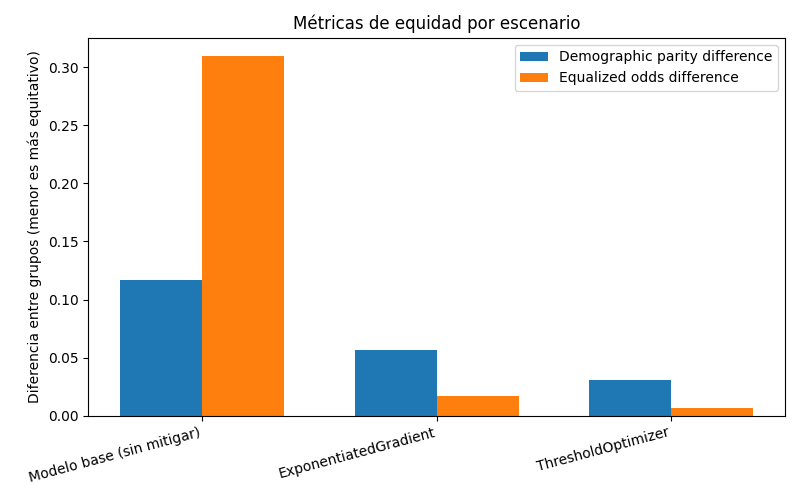
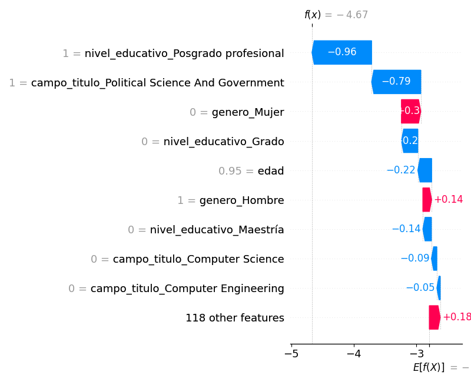
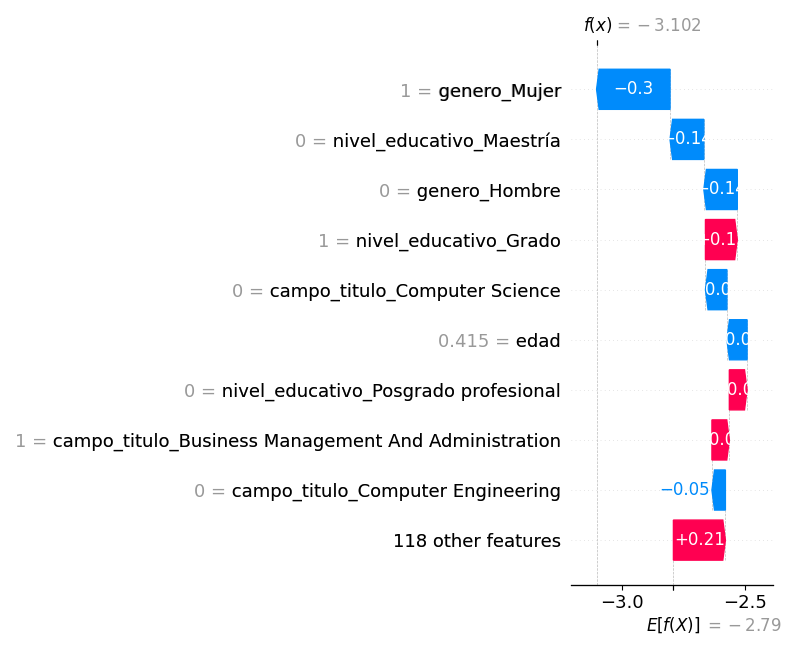
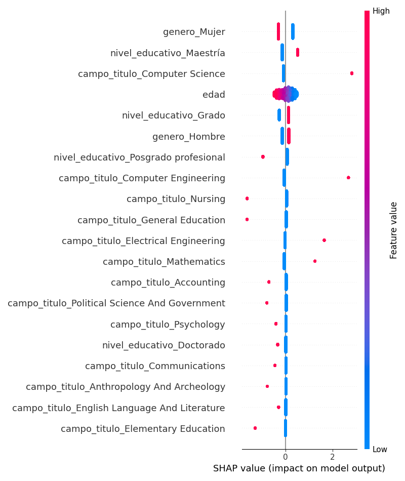

# Evidencias — Auditoría de equidad, mitigación y explicabilidad

_Generado automáticamente el 2026-10-15 23:54._

## Configuración de la corrida

- **Dataset:** data/acs_wa_tech_2024.csv
- **Columna objetivo:** `trabajo_tech` (clase positiva: `Tech`)
- **Atributo sensible:** `genero`
- **Método de mitigación:** `ambos`
- **Restricción de equidad:** `equalized_odds`

## Auditoría de equidad — modelo base (pre-mitigación)

- **Exactitud global:** 0.899
- **Demographic parity difference:** 0.117
- **Equalized odds difference:** 0.310
- **demographic_parity_ratio:** 0.085
- **equal_opportunity_difference:** 0.310

### Métricas por grupo

| Grupo | Exactitud | Tasa de selección |
|---|---|---|
| Hombre | 0.846 | 0.128 |
| Mujer | 0.946 | 0.011 |

### Interpretación

El patrón es el mismo que Reuters describió para Amazon. En el conjunto de test trabaja en tecnología el 19,4 % de los hombres y el 5,7 % de las mujeres, y el modelo, que aprendió de ese registro, selecciona al 12,8 % de los hombres y solo al 1,1 % de las mujeres. El cociente entre las dos tasas es 0,085 (`demographic_parity_ratio`), muy lejos del 0,8 que la regla de los cuatro quintos toma como señal de impacto adverso y también del 0,29 que hay en los datos (5,7 % contra 19,4 %), así que el modelo no se limita a copiar la desigualdad histórica sino que la agranda en términos relativos. La diferencia de equalized odds (0,310) coincide con la de igualdad de oportunidades porque sale de la brecha de verdaderos positivos: el modelo reconoce al 43,3 % de los hombres que trabajan en tecnología y apenas al 12,4 % de las mujeres en la misma situación (tabla 1 de `outputs/analisis_complementario.md`). Es el equivalente de lo que Reuters describe para Amazon, cuyo sistema bajaba el puntaje de los currículums de mujeres.

Como en Amazon, el origen está en los datos. La etiqueta registra quién ocupa hoy un puesto de tecnología, que es el resultado de años de desigualdad en el acceso a esas carreras y trabajos (sesgo histórico), y el modelo aprende esa desigualdad como si fuera un criterio de selección.

La mayor exactitud en mujeres (0,946 contra 0,846) no es una buena señal: sale de que el modelo casi nunca las selecciona y la mayoría efectivamente no trabaja en tecnología. Lo mismo pasa con la exactitud global de 0,899, que parece alta pero apenas supera el 0,878 que se obtiene prediciendo siempre "No tech"; la exactitud balanceada es 0,666.

## Comparación antes / después de la mitigación

| Escenario | Exactitud | Demographic parity diff. | Equalized odds diff. |
|---|---|---|---|
| Modelo base (sin mitigar) | 0.899 | 0.117 | 0.310 |
| ExponentiatedGradient | 0.897 | 0.056 | 0.017 |
| ThresholdOptimizer | 0.889 | 0.031 | 0.007 |

### Interpretación

Con la restricción de equalized odds las dos técnicas reducen mucho la disparidad. ExponentiatedGradient baja la diferencia de equalized odds de 0,310 a 0,017 y la de paridad demográfica de 0,117 a 0,056, y la exactitud casi no cambia (0,897 contra 0,899). En la práctica deja el TPR prácticamente igual entre géneros: 0,332 para hombres y 0,337 para mujeres. ThresholdOptimizer llega todavía más cerca de la igualdad (0,007), pero lo consigue sobre todo bajando el TPR de los hombres, de 0,433 a 0,220, mientras que el de las mujeres sube bastante menos que con ExponentiatedGradient (de 0,124 a 0,213, contra 0,337), y su exactitud balanceada cae de 0,666 a 0,601. En buena parte es una igualación hacia abajo: en un filtro real dejaría afuera a casi la mitad de los hombres calificados que antes pasaban y rescataría menos mujeres que la otra técnica.

Se observaron varias limitaciones. Ninguna técnica lleva la paridad demográfica a cero con esta restricción: como las tasas reales son distintas, igualar los errores no iguala las selecciones, y el cociente de selección mejora (0,383 con ExponentiatedGradient) pero sigue lejos de 0,8. Además, las métricas de equidad entran en tensión. Con `FAIRNESS_CONSTRAINT=demographic_parity` (tabla 4 del análisis complementario), ExponentiatedGradient acerca las tasas de selección (diferencia de 0,018, aunque el cociente queda en 0,625), pero la de equalized odds queda en 0,104 y el TPR se invierte (0,188 para hombres y 0,292 para mujeres); ThresholdOptimizer deja la paridad demográfica en 0,005 y la de equalized odds en 0,201. Es la incompatibilidad entre definiciones de equidad que plantea la unidad, y obliga a elegir: equalized odds toma como referencia un registro histórico que ya es desigual, mientras que la paridad demográfica lo cuestiona.

La exactitud casi no se mueve en ningún escenario, pero con clases tan desbalanceadas dice poco; la exactitud balanceada muestra mejor el costo de cada mitigación. Por último, las dos técnicas necesitan conocer el género para entrenar, y ThresholdOptimizer también para predecir, lo que en selección de personal puede considerarse trato desigual. También producen clasificadores aleatorizados, así que se fijó la semilla en `src/main.py` para que la corrida sea reproducible.

## Explicabilidad (SHAP) — modelo base

SHAP se aplica siempre sobre el modelo base, antes de cualquier mitigación: el objetivo es ver qué técnica de auditoría preventiva podría haber detectado el problema antes del despliegue (consigna 4).

### Predicción 4 — el atributo sensible más influyó

- Contribución absoluta de `genero`: 0.451
- Predicción del modelo: 0 · Valor real: 0

### Predicción 0 — el atributo sensible casi no influyó

- Contribución absoluta de `genero`: 0.434
- Predicción del modelo: 0 · Valor real: 0

### Resumen global

### Interpretación

SHAP aplicado al modelo base sí habría permitido detectar el problema antes de desplegar nada. En el resumen global, `genero_Mujer` es la variable con más peso medio del modelo, por encima del nivel educativo y de las carreras de computación, y su efecto es siempre negativo para las mujeres. Con eso alcanza para frenar un despliegue y preguntarse por qué el género está decidiendo.

Las dos predicciones de arriba hay que leerlas con cuidado. Como el modelo es lineal, el aporte SHAP del género es el mismo para todas las personas de un grupo: resta 0,434 puntos de log-odds a cada mujer y suma 0,451 a cada hombre. Por eso la predicción 4, "donde más influyó", es simplemente el primer hombre del conjunto de test, y la predicción 0, "donde casi no influyó", es la primera mujer, en la que el género pesa casi lo mismo pero en contra. Las dos tienen predicción y valor real 0, así que no muestran una decisión discriminatoria.

Para tener un caso que sí la muestre, el análisis complementario elige a una mujer que trabaja en tecnología y que el modelo descarta: 28 años, grado en Computer Engineering, probabilidad predicha de 0,499. El mismo perfil con género masculino obtiene 0,707 y pasaría el filtro (`outputs/shap_caso_mujer_descartada.png` y `outputs/shap_caso_gemelo_hombre.png`). En todo el test, invertir solo el género cambia el 4,7 % de las predicciones, y 15 de las 78 mujeres con trabajo tecnológico que el modelo descarta pasarían si fueran hombres. Es la versión tabular de lo que se podría haber hecho en Amazon: explicar con SHAP o LIME qué términos bajaban el puntaje, como "women's" o el nombre de una universidad femenina, y probar qué pasa al cambiar "women's" por "men's".

También muestra por qué no alcanza con quitar el atributo. Entrenado sin la columna de género, el modelo sigue seleccionando a los hombres cuatro veces más que a las mujeres (11,7 % contra 2,8 %) y la brecha de verdaderos positivos queda en 0,142, porque `campo_titulo` funciona como proxy del género (V de Cramér de 0,43). Es el riesgo que Reuters señalaba para Amazon: neutralizar algunas palabras no garantizaba que el sistema no encontrara otras formas de discriminar.

## Análisis complementario

Los números citados que no salen de la plantilla están en [`outputs/analisis_complementario.md`](outputs/analisis_complementario.md), generado en la misma corrida con `python -m analisis.complementario`: la tabla completa por grupo, el modelo sin la columna de género, la prueba contrafáctica, las dos restricciones de equidad con ambas técnicas y el caso SHAP elegido.
