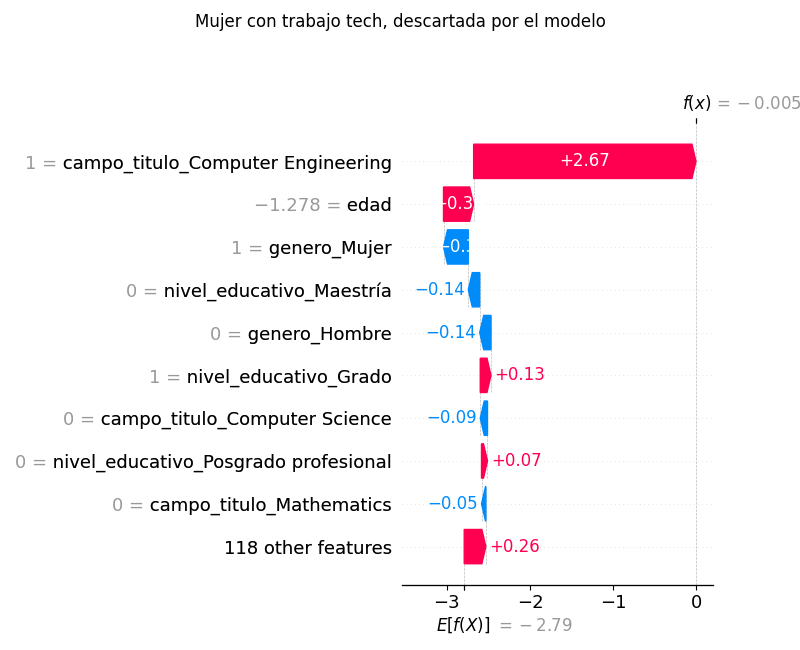
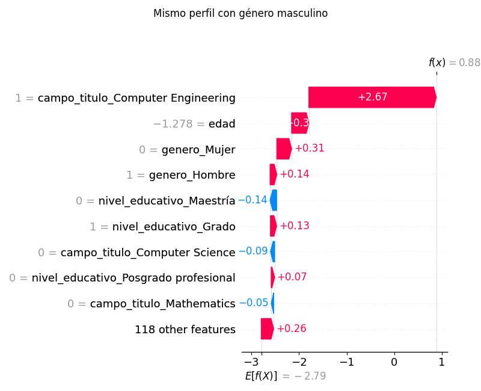

# Análisis complementario de la auditoría

## 1. Modelo base por grupo (test)

| genero | n | tasa_real | tasa_seleccion | tpr | fpr |
|---|---|---|---|---|---|
| Hombre | 1431 | 0.194 | 0.128 | 0.433 | 0.055 |
| Mujer | 1569 | 0.057 | 0.011 | 0.124 | 0.004 |

Exactitud balanceada: 0.666. Exactitud de predecir siempre la clase mayoritaria: 0.878.

## 2. Equidad por desconocimiento (modelo sin la columna de género)

| Escenario | Exactitud | Exactitud balanceada | DPD | EOD | Cociente DP | Selección Hombre | Selección Mujer | TPR Hombre | TPR Mujer |
|---|---|---|---|---|---|---|---|---|---|
| Sin la columna de género | 0.897 | 0.668 | 0.089 | 0.142 | 0.239 | 0.117 | 0.028 | 0.401 | 0.258 |

Asociación de cada variable con el género (candidatas a proxy):

| Variable | V de Cramér con el género |
|---|---|
| campo_titulo | 0.434 |
| edad | 0.058 |
| nivel_educativo | 0.048 |

## 3. Prueba contrafáctica (se invierte solo el género)

- Predicciones de test que cambian: 4.7%
- Mujeres que pasan de 'No tech' a 'Tech' con género masculino: 33
- Mujeres que sí trabajan en tecnología y el modelo descarta: 78, de las cuales 15 serían seleccionadas con género masculino

## 4. Restricciones de equidad comparadas (misma semilla que src/main.py)

| Escenario | Exactitud | Exactitud balanceada | DPD | EOD | Cociente DP | Selección Hombre | Selección Mujer | TPR Hombre | TPR Mujer |
|---|---|---|---|---|---|---|---|---|---|
| Modelo base | 0.899 | 0.666 | 0.117 | 0.310 | 0.085 | 0.128 | 0.011 | 0.433 | 0.124 |
| ExponentiatedGradient (demographic_parity) | 0.891 | 0.599 | 0.018 | 0.104 | 0.625 | 0.049 | 0.031 | 0.188 | 0.292 |
| ThresholdOptimizer (demographic_parity) | 0.885 | 0.598 | 0.005 | 0.201 | 0.897 | 0.044 | 0.049 | 0.170 | 0.371 |
| ExponentiatedGradient (equalized_odds) | 0.897 | 0.655 | 0.056 | 0.017 | 0.383 | 0.092 | 0.035 | 0.332 | 0.337 |
| ThresholdOptimizer (equalized_odds) | 0.889 | 0.601 | 0.031 | 0.007 | 0.473 | 0.058 | 0.027 | 0.220 | 0.213 |

## 5. Caso SHAP elegido: mujer con trabajo tech descartada y su gemelo masculino

- Perfil: edad=28, nivel_educativo=Grado, campo_titulo=Computer Engineering, genero=Mujer
- Probabilidad predicha de 'Tech': 0.499 (mujer) frente a 0.707 (mismo perfil, hombre)
- Aporte SHAP del género (log-odds): -0.434 (mujer) frente a +0.451 (hombre)

