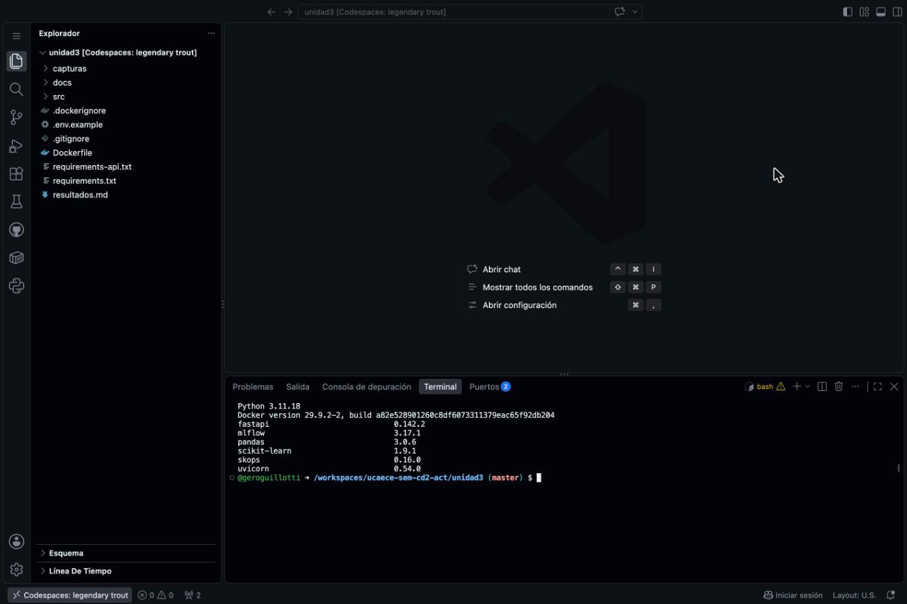
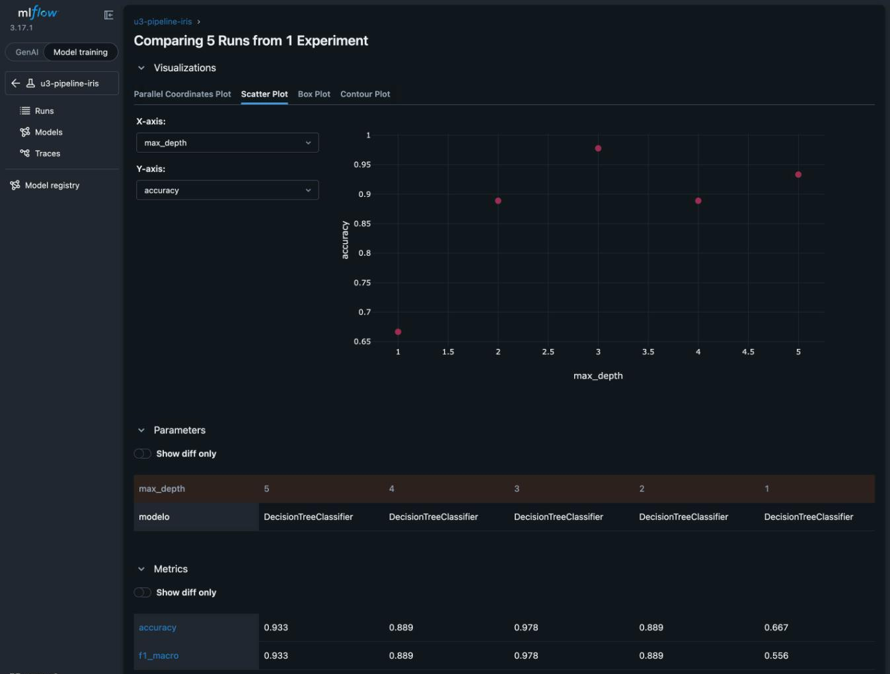
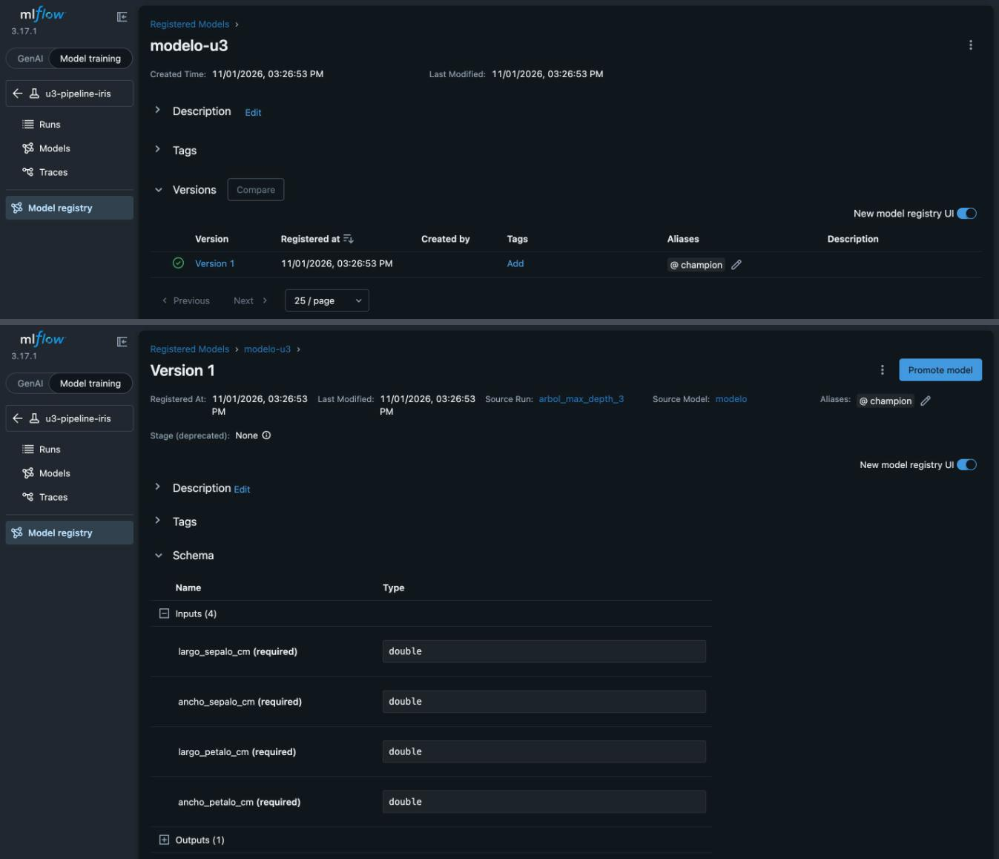
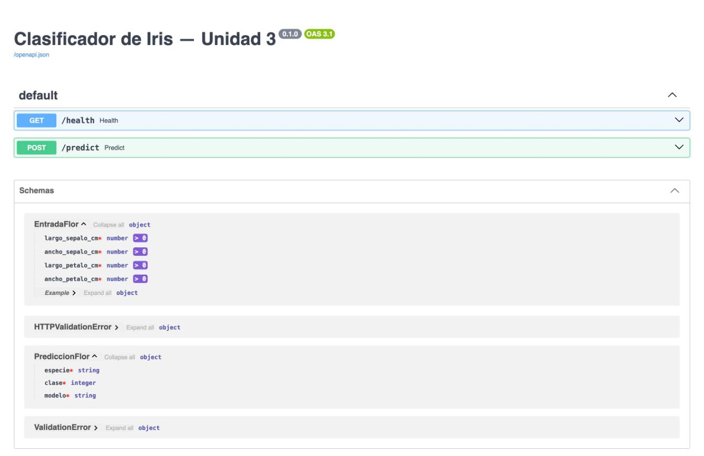
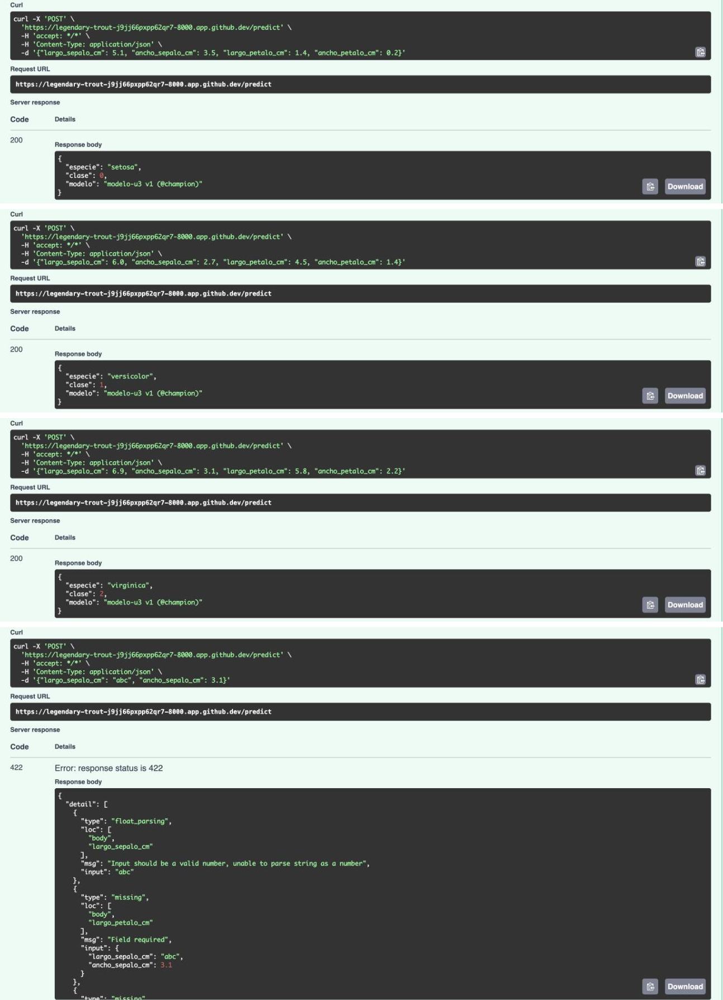
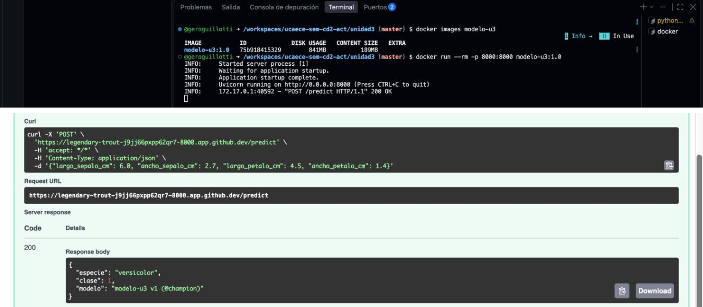
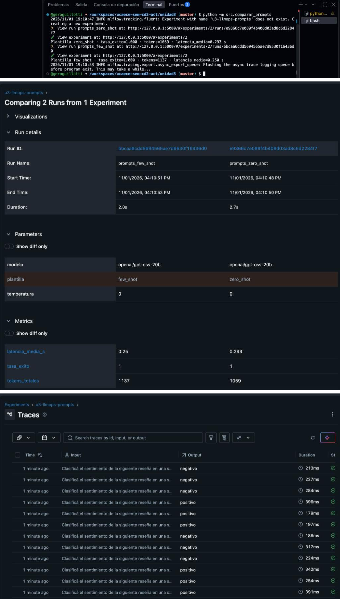

# Resultados — Unidad 3: MLOps/LLMOps

**Estudiante:** Geronimo Guillotti

**Fecha:** 1 de noviembre de 2026

---

## Consigna 6: Preparación del entorno

Codespace creado desde el fork con la configuración `unidad3-seminario-cd2`. El entorno trae Python 3.11.18,
Docker 29.9.2 y las dependencias de `requirements.txt` con versiones fijas (MLflow 3.17.1, scikit-learn 1.9.1,
FastAPI 0.142.2 y uvicorn 0.54.0, entre otras).

---

## Consigna 7: Experimentación y registro con MLflow

Se entrenó el árbol de decisión cinco veces, cambiando solo `max_depth` (semilla 42, 105 flores de entrenamiento y
45 de test, estratificadas). Las métricas son sobre el conjunto de test.

| Corrida | max_depth | accuracy | f1_macro |
|---------|-----------|----------|----------|
| arbol_max_depth_1 | 1 | 0,667 | 0,556 |
| arbol_max_depth_2 | 2 | 0,889 | 0,889 |
| arbol_max_depth_3 | 3 | 0,978 | 0,978 |
| arbol_max_depth_4 | 4 | 0,889 | 0,889 |
| arbol_max_depth_5 | 5 | 0,933 | 0,933 |

**Versión registrada:** modelo-u3 v1 (@champion), corrida con max_depth = 3

> La profundidad cambia mucho el resultado. Con max_depth = 1 el árbol hace un solo corte: separa setosa pero no
> distingue versicolor de virginica, y queda en 0,667 de accuracy y 0,556 de F1 macro. Con max_depth = 3 clasifica bien
> 44 de las 45 flores de test (0,978), y con 4 y 5 no mejora sino que baja, señal de que el árbol empieza a ajustarse a
> particularidades del entrenamiento. Registrar todas las corridas, incluidas las peores, es lo que justifica usar una
> herramienta de tracking (consigna 2): queda documentado qué se probó y con qué resultado, no se repiten
> configuraciones que ya fallaron y se puede mostrar con datos por qué se eligió la versión que pasó a producción.

---

## Consigna 8: Serving con FastAPI

API levantada con `uvicorn src.api:app --port 8000` a partir del modelo exportado con `python -m src.exportar_modelo`.
El contrato que muestra `/docs` es `POST /predict`: recibe un JSON con `largo_sepalo_cm`, `ancho_sepalo_cm`,
`largo_petalo_cm` y `ancho_petalo_cm` (números mayores que cero) y devuelve `especie`, `clase` y `modelo`. También hay
un `GET /health` para verificar que el servicio está vivo.

| Entrada | Respuesta de la API |
|---------|---------------------|
| `{"largo_sepalo_cm": 5.1, "ancho_sepalo_cm": 3.5, "largo_petalo_cm": 1.4, "ancho_petalo_cm": 0.2}` | 200: `{"especie": "setosa", "clase": 0, "modelo": "modelo-u3 v1 (@champion)"}` |
| `{"largo_sepalo_cm": 6.0, "ancho_sepalo_cm": 2.7, "largo_petalo_cm": 4.5, "ancho_petalo_cm": 1.4}` | 200: `{"especie": "versicolor", "clase": 1, "modelo": "modelo-u3 v1 (@champion)"}` |
| `{"largo_sepalo_cm": 6.9, "ancho_sepalo_cm": 3.1, "largo_petalo_cm": 5.8, "ancho_petalo_cm": 2.2}` | 200: `{"especie": "virginica", "clase": 2, "modelo": "modelo-u3 v1 (@champion)"}` |
| `{"largo_sepalo_cm": "abc", "ancho_sepalo_cm": 3.1}` | 422: `float_parsing` en `largo_sepalo_cm` y `missing` en `largo_petalo_cm` y `ancho_petalo_cm` |

> Si el dato no cumple el contrato, la API no llega a llamar al modelo. Pydantic valida el cuerpo contra el esquema
> `EntradaFlor` (cuatro números mayores que cero) y FastAPI responde con código 422 y el detalle de cada problema: en la
> prueba, que "abc" no es un número y que faltaban `largo_petalo_cm` y `ancho_petalo_cm`. En producción eso evita que
> un dato mal formado termine en una predicción inventada con código 200, que nadie notaría, le indica al cliente qué
> corregir y permite contar los errores de entrada por separado en el monitoreo.

---

## Consigna 9: Containerización con Docker

Imagen construida con `docker build -t modelo-u3:1.0 .` (841 MB en disco) y contenedor ejecutado con
`docker run --rm -p 8000:8000 modelo-u3:1.0`. La predicción de versicolor repetida contra el contenedor devolvió lo
mismo que la API local, incluido `modelo-u3 v1 (@champion)`, porque la imagen lleva adentro la carpeta
`modelo_exportado/` y no depende del servidor de MLflow. En el log del contenedor se ve el pedido con código 200.

> Con `modelo-u3:1.0` y `modelo-u3:1.1` se pueden levantar dos contenedores a la vez, cada uno con su versión del modelo
> adentro, sin tocar el que está en producción. Para el canary release elegido en la consigna 3 alcanzaría con poner
> adelante un balanceador que mande una parte chica del tráfico, por ejemplo el 10 %, al contenedor 1.1 y el resto al
> 1.0, comparar errores, latencia y respuestas, e ir subiendo el porcentaje si todo va bien. Si algo falla se vuelve todo
> al 1.0, que sigue corriendo igual. Como cada respuesta trae el campo `modelo`, se sabe qué versión contestó cada pedido.

---

## Paso opcional: LLMOps con Groq

Comparación de las plantillas zero-shot y few-shot con `openai/gpt-oss-20b` en Groq (temperatura 0, seis reseñas),
registrada en el experimento `u3-llmops-prompts` con una traza por llamada gracias a `mlflow.groq.autolog()`. La clave
de Groq se cargó como secreto de Codespaces, sin escribirla en ningún archivo del repositorio.

| Plantilla | tasa_exito | tokens_totales | latencia_media_s |
|-----------|------------|----------------|------------------|
| zero_shot | 1,000 | 1059 | 0,293 |
| few_shot  | 1,000 | 1137 | 0,250 |

> Las dos plantillas acertaron las seis reseñas, así que con un conjunto tan fácil los ejemplos no mejoran la tasa de
> aciertos y solo suman costo: few-shot usó 78 tokens más, un 7 % más. La diferencia de latencia (0,250 contra 0,293 s)
> entra en la variación entre llamadas, que en las trazas va de 179 a 396 ms. Para justificar los ejemplos haría falta
> evaluar con casos difíciles, como reseñas irónicas o mixtas.
